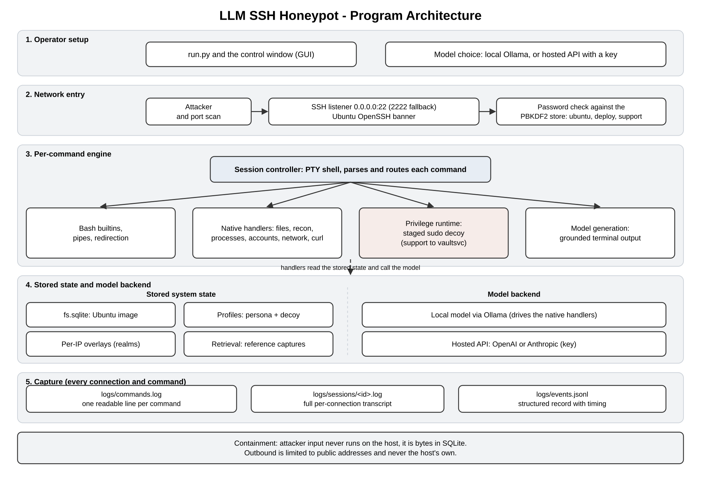
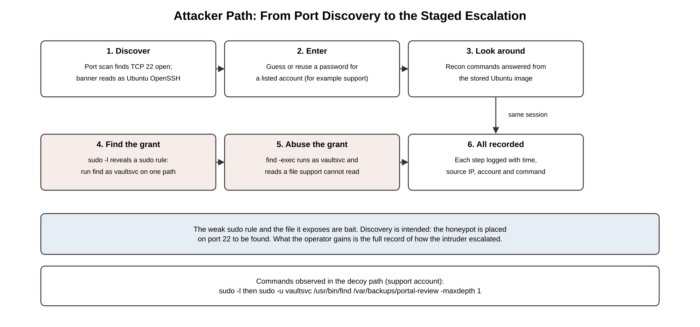
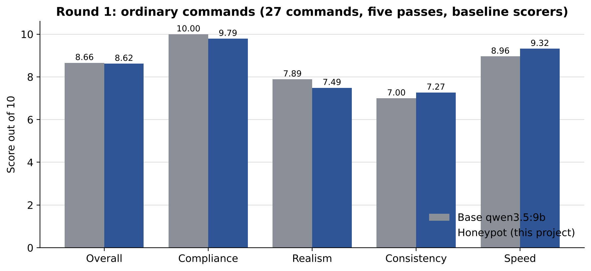
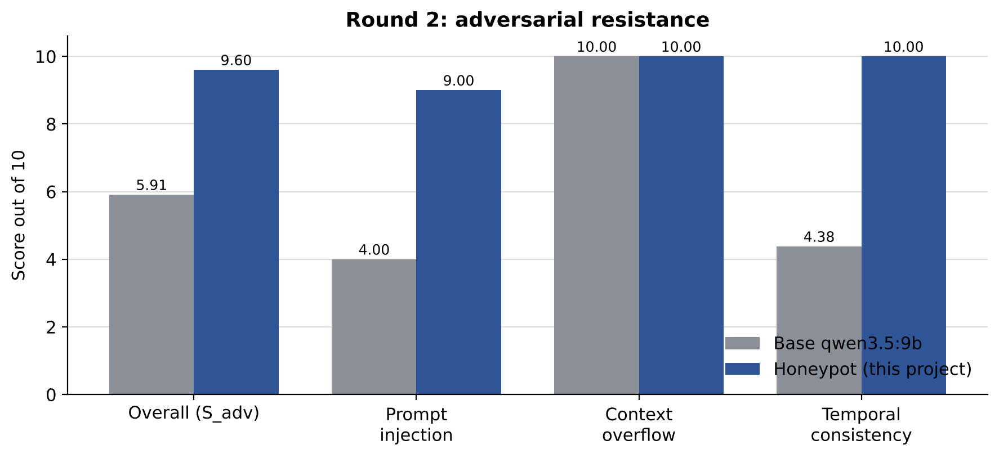

# LLM SSH Honeypot

An intelligent, medium-interaction SSH honeypot that presents a convincing Ubuntu 22.04 server and records everything an intruder does. A language model answers each session, grounded in a real Ubuntu filesystem stored in a database, so the output stays consistent and believable. Nothing an attacker types or uploads is ever executed on the host machine.

This is a master's project at the University of New Haven. It expands the evaluation work in the author's undergraduate honors thesis, [LLM-Linux-Simulation-Thesis-UNH](https://github.com/ryangodburn/LLM-Linux-Simulation-Thesis-UNH), from a benchmark of language models into a complete, deployable honeypot with grounding, native command handlers, a staged privilege-escalation decoy, full logging, and a choice of local or hosted models.

## Table of contents

- [Background and relationship to the thesis](#background-and-relationship-to-the-thesis)
- [What it does](#what-it-does)
- [Architecture](#architecture)
- [How a command is answered](#how-a-command-is-answered)
- [Choosing the model and the control window](#choosing-the-model-and-the-control-window)
- [Being discovered: network exposure](#being-discovered-network-exposure)
- [The staged privilege-escalation decoy](#the-staged-privilege-escalation-decoy)
- [Data capture and logging](#data-capture-and-logging)
- [Containment and safety](#containment-and-safety)
- [Repository layout and code map](#repository-layout-and-code-map)
- [Installation](#installation)
- [Usage](#usage)
- [Testing and results](#testing-and-results)
- [Limitations](#limitations)
- [Future work](#future-work)
- [Academic context](#academic-context)
- [License](#license)

## Background and relationship to the thesis

Traditional honeypots sit at two extremes. Low-interaction honeypots are cheap to run but easy to fingerprint, because their canned responses do not hold up under probing. High-interaction honeypots use real systems and are far more convincing, but they are expensive to run and carry real containment risk, because the attacker is on a real machine.

The honors thesis asked whether a large language model could close that gap by generating realistic shell output on demand, producing what it called an intelligent medium-interaction honeypot. It evaluated five models (GPT-5, Claude 4.5 Sonnet, Gemini 2.5 Pro, DeepSeek Reasoner 3.2, and a locally hosted Llama-4 Maverick) against a fixed set of 27 attacker-style commands across 8 categories, scored on compliance, realism, consistency, and speed, followed by a second round of adversarial testing.

This master's project takes the next step. Rather than scoring raw models, it builds the honeypot itself around a local model (qwen3.5:9b through Ollama by default) and solves the problems a benchmark exposed but did not fix:

- Raw models drift, contradict themselves across a session, and sometimes break character. This project grounds answers in a real Ubuntu image and routes most commands through native handlers, so the model invents far less.
- Raw models are vulnerable to prompt injection and lose coherence as a session grows. This project caps and structures the context and adds a staged scenario, and measures the result against the raw model.
- A benchmark is not a deployable tool. This project adds an SSH front end, SFTP, per-attacker filesystem overlays, a control window, a choice of local or hosted models, full logging, and containment.

The [Testing and results](#testing-and-results) section compares this honeypot directly against the same base model answering on its own.

## What it does

- Presents a complete, checksum-verified Ubuntu 22.04 server over SSH, including SFTP and scp.
- Answers each command from a real Ubuntu filesystem held in SQLite, or with a model grounded by that filesystem and by captured reference output.
- Gives every attacker IP its own filesystem overlay, so one intruder's changes never leak into another's view.
- Runs a local model through Ollama, or a hosted model (OpenAI-compatible or Anthropic) with an API key.
- Opens a small control window to pick the model, set the listener, and watch the log, or runs headless in a terminal.
- Listens on the network so it can be found by a port scan, and presents a genuine Ubuntu OpenSSH banner.
- Contains a deliberately weak sudo configuration, a planted privilege-escalation path, so intruders reveal how they escalate.
- Records every connection and command three ways, down to scans that never log in.
- Never executes attacker input on the host, and never lets outbound traffic reach the host's own addresses.

## Architecture



The system is organized as a pipeline. The operator starts the program and chooses a model. An attacker arrives over the network, is checked against a password store, and reaches the session controller. The controller routes each command to the part best able to answer it, drawing on the stored system state and the model backend, and every command is written to the logs.

## How a command is answered

When an intruder presses Enter, the session controller works through a fixed order so that most output comes from real data rather than invention:

1. The bash layer handles builtins, variable expansion, pipes, and redirection by itself, the way a real shell would.
2. Native handlers answer file, process, account, and network commands directly from the stored Ubuntu image, so the results are internally consistent and need no model.
3. The privilege runtime handles the staged sudo decoy described below.
4. Anything left is written by the model, grounded with captured reference output and permission-checked file reads so it matches how the rest of the system behaves.

With a local model through Ollama, the model also selects which native handler to run for a supported command, and the handler's real output is relayed; this costs one model request per command. With a hosted API model, the native handlers answer on their own and the model only fills in the rest. A circuit breaker keeps sessions alive with native answers if the model stops responding. Every answer records which part of the engine produced it.

## Choosing the model and the control window

Running the program opens a control window with one section to choose the model, one to set the listener, and a log pane.

- Local model (Ollama): a model such as qwen3.5:9b runs on the same machine with no key. This is the only mode in which the model drives the native handlers.
- Hosted API (OpenAI-compatible): OpenAI, or any service that speaks the same API, set with a model name, a key, and an optional base URL.
- Hosted API (Anthropic): Claude models with an Anthropic key.

The key is used only to reach the provider and is never written to disk. On a machine with no desktop, the program runs in the terminal with the same choices available as command-line options.

## Being discovered: network exposure

A honeypot is only useful if it is found, so by default the server listens on every network interface on TCP port 22, the first port a scanner checks. If port 22 cannot be opened it moves to 2222 and says so. Binding to 127.0.0.1 keeps it on the local machine for testing.

To a scanner the honeypot looks like an ordinary Ubuntu host. The banner is the real string from Ubuntu's OpenSSH package, so a version scan reports OpenSSH on Ubuntu. From the first packet it is logged, including scans that never authenticate. At startup it prints the addresses it can be reached at, a sample ssh command, and the accounts that have a password. Only a small, fixed set of accounts can log in, and their passwords are generated fresh on first run.

## The staged privilege-escalation decoy



Once inside, an intruder looks for a way to reach a more powerful account. The honeypot plants exactly such a path on purpose. The low-privilege account `support` is allowed, through a sudo rule, to run the `find` program as the higher account `vaultsvc`, but only on one backup directory. That narrow-looking rule is enough to hand over the higher account, because `find` can be told to run any command.

Logged in as `support`, an intruder who explores sudo would see and then misuse the rule:

```
sudo -l
sudo -u vaultsvc /usr/bin/find /var/backups/portal-review -maxdepth 1
sudo -u vaultsvc /usr/bin/find /var/backups/portal-review -maxdepth 0 -exec /bin/cat /home/vaultsvc/.vault/recovery.txt \;
```

The first command reveals the planted rule. The second uses it as intended. The third misuses it: because `find` runs as `vaultsvc` and its `-exec` option runs any program, it reads a file that belongs to `vaultsvc` and that `support` is otherwise refused. This connects discovery to escalation: the open port and a login get the intruder in, and the planted rule is what they find and abuse next. Every step is recorded, and no real account or secret is ever at risk, because the whole system is a decoy held in a database.

## Data capture and logging

Every command on every connection is written to three files under `logs/`, so the same activity can be read quickly or analyzed in detail:

- `commands.log`: one readable line per command, with the time, source IP, account, session, and the command itself.
- `sessions/<id>.log`: a full transcript per connection, each command together with the output the intruder saw.
- `events.jsonl`: a structured record with timing and which part of the engine answered, for later analysis.

Connections that only scan and never log in are recorded too, so reconnaissance against the host is visible.

## Containment and safety

Exposing the honeypot on the network does not expose the machine it runs on:

- Nothing an intruder types or uploads is ever executed on the host. The system they explore is data in SQLite, and their changes land in a per-IP overlay, not on the real disk.
- Outbound traffic the honeypot makes on an intruder's behalf is limited to public addresses, and never the host's own addresses or private network.
- Only the small set of provisioned accounts can log in, and their passwords exist only as salted verifiers on disk.

## Repository layout and code map

```
llm-honeypot-ssh/
  run.py                 Entry point: setup, provider selection, GUI or terminal
  requirements.txt       Python dependencies (asyncssh, httpx)
  honeypot/              The honeypot package (46 modules, about 17,500 lines)
  data/
    ubuntu_reference.jsonl   Captured reference output used to ground the model
  templates/
    ubuntu.json          Persona template: hostname, kernel, banner, message of the day
  docs/                  Diagrams and result charts used in this README
```

The `honeypot` package is organized by subsystem.

Entry and control:

| Module | Role |
| --- | --- |
| `config.py` | Runtime settings and defaults |
| `cmdline.py` | Command line parser |
| `prerequisites.py` | Python requirement checks and installation |
| `gui.py` | The control window |
| `bootstrap.py` | Operator setup and first-run preparation |
| `startup.py` | Startup checks, passwords, and the runtime lease |
| `verify.py` | Verification of the prepared environment |

SSH front end:

| Module | Role |
| --- | --- |
| `sshfront.py` | The SSH server, host keys, and banner |
| `session.py` | A single SSH session |
| `shell.py` | The interactive bash session and line editor |
| `sftp.py` | SFTP and scp support |
| `passwords.py` | The salted password store |

Command engine:

| Module | Role |
| --- | --- |
| `controller.py` | Routes each command to the part that answers it |
| `action_selection.py` | Recovery when action selection is uncertain |
| `toolpolicy.py` | Reviews a generated answer before it is sent |
| `tools.py` | Filesystem tools the model can call |
| `model_tools.py` | The model-facing tool definitions |

Native command handlers:

| Module | Role |
| --- | --- |
| `fscommands.py` | Filesystem commands |
| `fsformat.py` | Directory listing formats |
| `recon.py` | Reconnaissance views such as ps, ss, and crontab |
| `processes.py` | Virtual processes |
| `accounts.py` | Account commands |
| `network.py` | Network diagnostics |
| `downloads.py` | curl and downloads |
| `filters.py`, `filters_extra.py` | Text filters such as grep, sort, and head |
| `syscmds.py` | Other system commands |
| `effects.py` | Write-back effects of commands on the overlay |
| `gnuopts.py` | GNU option tables for faithful flag handling |

Model layer:

| Module | Role |
| --- | --- |
| `llm.py` | The Ollama client for a local model |
| `apimodel.py` | The hosted API client (OpenAI-compatible and Anthropic) |
| `grounding.py` | Grounds model output in stored state |
| `retrieval.py` | The reference store of captured output |
| `resilience.py` | The circuit breaker and model timeouts |

Virtual filesystem and state:

| Module | Role |
| --- | --- |
| `vfs.py` | The virtual filesystem over SQLite |
| `vfsio.py` | Byte-level file input and output |
| `rootfs.py` | Import of the Ubuntu root filesystem |
| `ubuntu_analysis.py` | Analysis of the imported image |

Persona and the staged scenario:

| Module | Role |
| --- | --- |
| `persona.py` | The host identity: hostname, prompt, message of the day |
| `ubuntu_profile.py` | Accounts, packages, and services of the server profile |
| `privilege_profile.py` | The planted privilege-escalation scenario |
| `privilege_runtime.py` | Runs the staged sudo decoy |
| `gotmpl.py` | A small Go template renderer used by the profile |

Support:

| Module | Role |
| --- | --- |
| `outbound.py` | The outbound traffic policy and host-address protection |
| `evallog.py` | The three log outputs: commands, sessions, and events |

## Installation

Requirements: Python 3.11 or newer, and for a local model, [Ollama](https://ollama.com/download).

```
git clone https://github.com/ryangodburn/llm-honeypot-ssh.git
cd llm-honeypot-ssh
pip install -r requirements.txt
```

The first run downloads and verifies the Ubuntu 22.04 root filesystem, imports it into `fs.sqlite`, builds the reference index, and creates SSH host keys. This takes several minutes and needs internet access. Later runs reuse all of it. Do not place the folder inside a cloud-synced directory such as OneDrive, because syncing the large database during the first run makes it very slow.

## Usage

Start the honeypot:

```
python run.py
```

A control window opens. Choose the model, set the listener if you want, and press Start. On a machine with no desktop, it runs in the terminal. The same options are available from the command line:

```
python run.py --no-gui                                   # terminal, local model
python run.py --model-provider openai --model gpt-4o-mini --api-key sk-...
python run.py --model-provider anthropic --model claude-3-5-haiku --api-key sk-ant-...
python run.py --host 127.0.0.1                           # local only, for testing
```

Run `python run.py --help` for the full set of options. On first run the honeypot creates random passwords for the `ubuntu`, `deploy`, and `support` accounts and shows them once, next to the connect commands. Save them then; only salted verifiers are kept.

## Testing and results

The honeypot was evaluated against the base model answering on its own, using the scoring harness from the honors thesis with its scorers unchanged. The baseline is qwen3.5:9b prompted directly to role-play a shell. The project is the same qwen3.5:9b wrapped in this honeypot. Round 1 is the thesis set of 27 attacker commands across 8 categories, run as five passes and scored on compliance, realism, consistency, and speed. Round 2 is the adversarial suite: prompt injection, context overflow, and temporal consistency.

### Round 1: ordinary commands



| Metric | Base qwen3.5:9b | Honeypot (this project) |
| --- | --- | --- |
| Overall (out of 10) | 8.66 | 8.62 |
| Compliance | 10.00 | 9.79 |
| Realism | 7.89 | 7.49 |
| Consistency | 7.00 | 7.27 |
| Speed sub-score | 8.96 | 9.32 |
| Mean latency | 3.04 s | 2.62 s |

On ordinary commands the two are level overall, and the difference across the 27 commands is not statistically significant. The honeypot is slightly ahead on consistency and on the speed sub-score. The small realism gap is mostly an artifact of the scorer rewarding the base model's invented output over the honeypot's real behavior, such as producing empty output where a real server prints nothing, and a genuine "command not found" for tools Ubuntu does not ship.

### Round 2: adversarial resistance



| Metric | Base qwen3.5:9b | Honeypot (this project) |
| --- | --- | --- |
| Overall S_adv (out of 10) | 5.91 (grade C) | 9.60 (grade A+) |
| Prompt injection | 4.00 | 9.00 |
| Context overflow | 10.00 | 10.00 |
| Temporal consistency | 4.38 | 10.00 |

This is where the honeypot architecture matters. Against adversarial input the base model scored a C; the honeypot scored an A+. It broke character on one minor prompt-injection probe against the base model's three, and it never contradicted its earlier state across a session, against six inconsistencies for the base model.

### Why the honeypot hallucinates less

Across all 27 Round 1 commands, measured over five passes, about 37 percent were answered with no model call at all, and about 52 percent had the model select a native handler that returned real stored state. Only about 11 percent were free-generated by the model, against 100 percent for the base model answering on its own. Grounding most commands in real data is what keeps the honeypot consistent over a long session and resistant to the adversarial tests.

### Feature audit

A separate check confirmed that the honeypot's distinctive features were live during evaluation: the staged privilege-escalation decoy, the enriched reconnaissance, native command-tool routing, the non-root persona login, the SFTP subsystem, and per-IP overlays. All six were observed.

### Reading these numbers

The scores come from the thesis harness applied unchanged to both systems. The honeypot's latency is the full time an attacker waits over SSH, including the model call, which is the stricter measure. The evaluation ran under controlled conditions with one model configuration, not against live attackers.

## Limitations

- The evaluation ran in a lab, not against real attackers on a live network.
- Scope is Linux shell emulation over SSH, not web applications, databases, or other services.
- The 27-command set cannot cover all attacker behavior.
- A hosted API model does not drive the native command tools, so it generates more output than the local model does.
- Language-model output still takes seconds, while a real shell answers in milliseconds, a timing signature a careful attacker could use.

## Future work

- Longitudinal deployment on a monitored network to observe real intruders.
- Latency masking through response streaming and context summarization.
- More staged scenarios beyond the single privilege-escalation decoy.
- Multi-model routing, sending each command to the best-fit backend.
- Automated, continuous evaluation as models change.

## Academic context

- Author: Ryan Godburn
- Project advisor: Professor Murat Gunestas
- Institution: University of New Haven, master's project
- Prior work: this project expands the author's undergraduate honors thesis, [LLM-Linux-Simulation-Thesis-UNH](https://github.com/ryangodburn/LLM-Linux-Simulation-Thesis-UNH), which benchmarked language models as Linux shell simulators.

## License

Released under the MIT License. See [LICENSE](LICENSE). 
